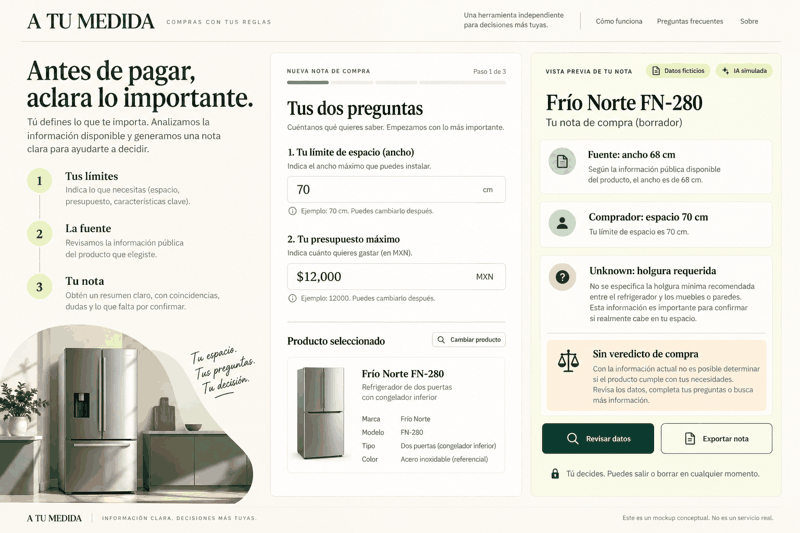
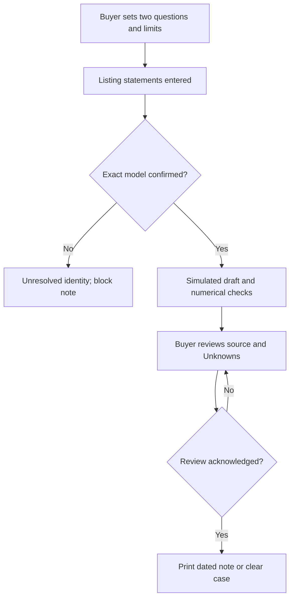
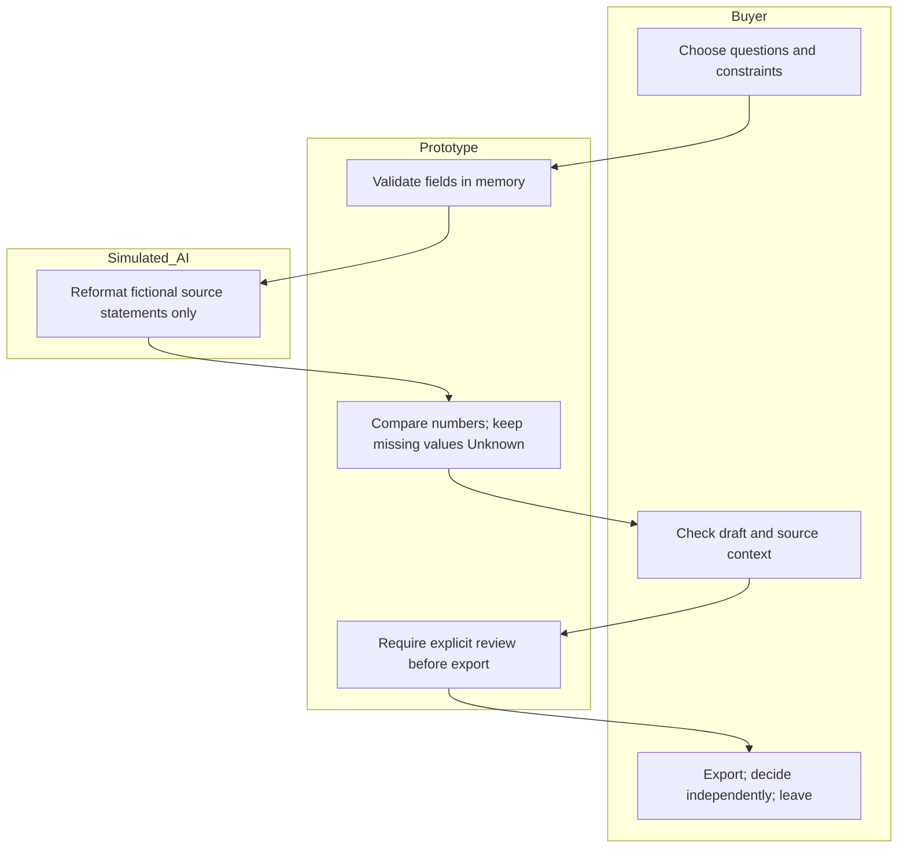

# A TU MEDIDA — buyer-controlled purchase note
Fernanda Espinosa · Business Bending Week 10 · Operator · 19 October 2026 UTC

## Evidence boundary
Source: supplied BRIEF_FernandaEspinosa(8).pdf, two pages. Also supplied: BLUEPRINT_team week 10.pdf, marked PROPOSED for team approval, not a completed vote. Implement Fernanda’s declared scoped intake, source log and export; preserve conditions 1–6 below without asserting team ratification. No participants, willingness-to-pay results, laboratory tests, or reduced-regret results exist. This packet precedes application code in Git history.

## Problem and exact user
A buyer may pay before clarifying a practical mismatch. One adult in Mexico, already considering a specific refrigerator listing, wants two questions clarified within a decision window. The buyer, not a retailer, sets priorities. Refrigerators are illustrative, not a validated market selection.

## Working slice and success
Before this module closes, a visitor can load a fictional case, edit two questions and numerical constraints, review source statements against their limits, preserve Unknown fields, acknowledge exact-model matching and human checking, and print an exportable dated purchase note. The visitor can clear the entire case. No purchase verdict or automated purchase occurs.

## Image-generated mockup

Cream, forest-green, buyer-first form and traceable note. The final app may differ. Generated before implementation; conceptual image is committed with this packet.

## Flow

## Responsibility swimlane

## Benchmark, verified 19 October 2026 UTC
The strongest researched benchmark for independent testing plus buying advice is Which?, which publishes testing and editorial-independence policies; this is a reasoned benchmark choice, not an exhaustive global ranking. Mine localizes to two buyer-defined questions for a Mexican listing and separates unverified listing statements from the buyer's constraints; it does not reproduce laboratory testing.
Which? discloses membership and affiliate funding. This prototype has no sellers, affiliate links, or payment collection. Profeco QQP already supplies price comparisons including appliances; a paid service must add useful clarification beyond that free baseline.
Sources: https://www.which.co.uk/about-which/our-statement-of-editorial-independence-aFnFu0X8HMSl ; https://www.which.co.uk/help/your-which-membership-a8M9A8b753w3 ; https://qqp.profeco.gob.mx/ .

## Long view — three sentences
In three years, if buyer-led trials justify it, the product could become a bounded independent clarification service across a few supported appliance categories. Trained operators would deliver dated, auditable notes within measured capacity, with a backup, correction channel, and disclosed limited retention. Expansion would depend on accuracy, useful clarification beyond a free checklist, full delivery costs, and actual buyer payment behavior rather than engagement or seller conversion.

## Scope cut
No store, product ranking, seller recommendations, checkout, retailer contact, live scraping, current price verification, payment, account, backend database, personal purchase histories, real incident claims, or actual operator dispatch. No AI API is called; its output is explicitly simulated. Only invented demo data is requested; all case fields remain in volatile browser memory. Browser print-to-PDF is an actual export interaction, not an automatic server PDF.

## Architecture and Dragon Stack
| Layer | Implementation | Boundary |
|---|---|---|
| LLM | Model-assisted build and labeled simulated structured draft | No runtime model call; no truth claim |
| User-constraint data | Two questions; budget MXN; available width cm; exact variant | User-entered, volatile memory |
| Third component | Deterministic constraint automation and print export | Arithmetic only; no shopping agent |
| Interface | Static HTML/CSS and vanilla JavaScript ES module | Free buildless deployment |
| Storage | None: no database, localStorage, cookies, analytics | Reload/clear discards case; exported files remain with buyer |
| Hosting/source | Sites static hosting and managed Git | Owner-private default; GitHub handoff separately required |

## Brief conditions and shadow clause
Two buyer-chosen questions; exact model gate; supplied source context preserved verbatim; source statements distinct from buyer data and calculations; Unknown preserved; no inferred delivery/return guarantee. A width difference is not installation clearance: unknown required ventilation must prevent a fit conclusion. Buyer can edit, stop, export, or clear without penalty. No urgency tactics, emotional profiling, hidden alternatives, seller commissions, or purchase verdict. Operator approves no real cases in this prototype; actual assisted delivery needs named primary/backup, capacity cap, agreed turnaround, limited retention and correction/remedy workflow before pilot.

## Security floor before build
1. No API keys required or committed. 2. No personal information requested or persistently stored; auth therefore not applicable to this volatile fictional-data demo. Real records require auth before storage. 3. No Supabase tables; RLS not applicable. 4. Validate all input lengths, optional finite positive numbers and safe source URL scheme; render input with textContent, never raw HTML. 5. Fictional case and simulated AI labels visible on screen and export. Exported PDFs are user-controlled; do not enter real personal data.

## Test plan, declared before code
Mechanical: blank numeric fields remain Unknown; comma decimal normalization; finite positive ranges; width mismatch; budget mismatch; insufficient clearance data; missing model match and review gate; stale acknowledgement reset after edit; unsafe source URL; HTML text inert; clear and print behavior. Deliberate goal is to discover actual defects, not invent a bug; record failing reproduction and repair commit if found. Deploy functional initial version, run tests, fix, redeploy.
Persona: fresh synthetic-user session based on a clearly hypothetical adult buyer, cautious about apps and uncertain about units. Walk through screens, log hesitation, fix worst confusion. No screenshots or browser QA may be claimed if the environment lacks the required browser capability; text-only review is partial evidence and the screenshot-based test remains outstanding.
Pilot later: five adults, compare free checklist with assistance; record total effort, errors, useful clarification, deadlines, pressure, rejected/unfinished cases, recruitment and corrections. Stop if service duplicates free checklist, arrives late, creates burden, or requires inaccessible data. Five cases cannot validate reduced regret.

## Commit and deploy plan
1 packet and mockup; 2 precise implementation prompt; 3 constraints and input validation; 4 form/draft/export interface and deploy 1; 5 measured bug repair plus regression tests; 6 persona clarity repair and session close, deploy 2. Keep actual hashes and deployment IDs in TEST_LOG.md; do not pad commits or claim execution not performed.

## Blueprint condition mapping
1 Autonomy: two self-selected questions, no purchase blocking, clear and export; exact-model/review gates block only an unreviewed note. 2 Evidence: separate source statements, buyer information, assumptions, contradictions and Unknown; manual source-check flag is an attestation, not independent verification. 3 Funding: no commissions, ranking, payment or affiliate links. 4 Minimal data: no account linking; zero server retention of case contents; browser-memory only until clear/reload; exported files are buyer-controlled. 5 Five shoppers versus free checklist: explicit unexecuted pilot, no real-user claims; checklist is provided in-app. 6 One listing/two questions: immediate automated draft only, no real operator queue; capacity one local case per tab, no promised human turnaround; correction route is edit → regenerate → replace earlier export. For a real service, primary/backup, capacity and agreed response time remain gates before launch.

## Final execution addendum (after implementation)
Two private deployments verified succeeded. Initial code db805d22a7bb9a7c6600a0d0121f4d3592411fd2; repaired code afce83e316a6f6ff7a0a243797f557917f8c92f9. Initial regression 9/14 pass; repaired 14/14 pass. Independent fresh text-only persona review and retest completed; screenshot test remains outstanding. Live owner-private URL: https://a-tu-medida-w10.mafer212005.chatgpt.site . No GitHub repo URL or recorded demo exists yet. BUILDCHAT evidence log is explicitly reconstructed and must be supplemented/replaced with full conversation export.
