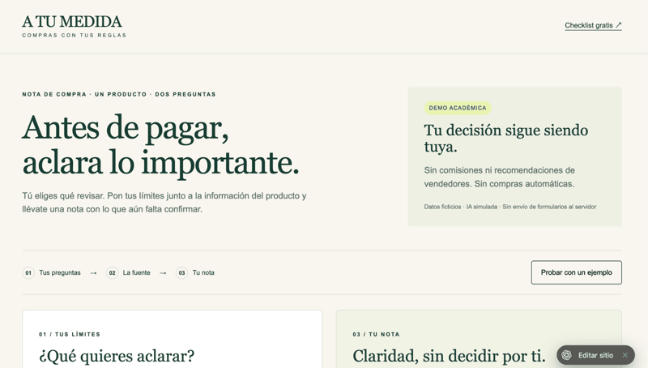
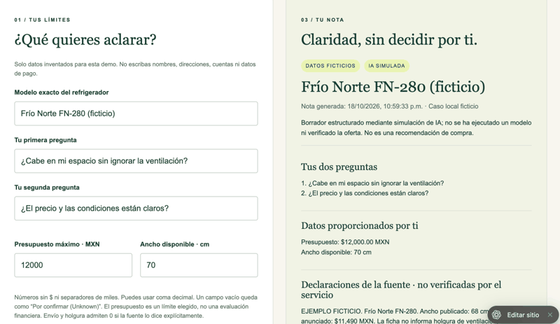
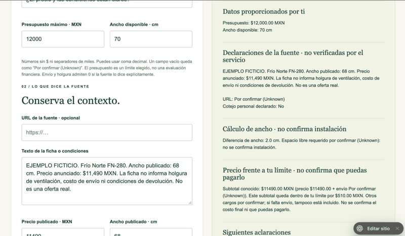

# PERSONA TEST — Fernanda Espinosa
Week 10 · 19 October 2026 UTC

## Status and method
Phase A: independent fresh text-only review of actual source code. Phase B: a separate fresh synthetic-user session inspected three actual browser screenshots supplied by the user, in chronological order. No real shopper participant or real user research. The synthetic reviewer did not click, edit, print or delete. Screenshot evidence now covers landing, form/note top and source/calculations; export, deletion, mobile and a post-fix visual retest remain unobserved.

## Persona and task
Lucía, fictional adult aged 42 in Mexico considering a refrigerator. Comfortable with WhatsApp, cautious about unfamiliar apps and ambiguous terms. Wants to know whether it fits and what she will pay. Inferred from the brief's adult buyer and practical-questions context; age, communication habits and hesitation are hypothetical design assumptions.

Fresh-session instruction: Represent Lucía and read index.html, app.js, core.js and style.css. Walk landing, loaded example, generated note, review/export and clear/checklist sequentially. Narrate in Spanish; log confusions, rank worst issue and propose retest acceptance. Do not modify files. Explicitly state text-only limitation, with screenshots outstanding.

## Original reactions and findings
| State | Hypothetical persona reaction | Finding |
|---|---|---|
| Empty landing | “Me tranquiliza que no compren por mí. Pero veo muchos pasos; primero quiero ver cómo queda.” | Example loader offers a starting point. |
| Example | “¿La holgura es dos centímetros de cada lado o dos entre los dos? ¿Por qué ya está marcada la confirmación del modelo?” | Clarify total side clearance; never pre-check confirmation. |
| Generated note | “¿Por qué mi presupuesto ahora es una frase y no los doce mil? ¿Y cuánto pagaré finalmente?” | Numeric budget overwritten by assessment string; shipping ignored. |
| Review/export | “Dice Unknown varias veces. Entiendo que falta algo, pero quiero saber exactamente qué preguntar antes de guardar.” | Plain Spanish and next questions needed; print behavior unverified. |
| Clear/checklist | “Borrar sí me deja claro que el PDF sigue conmigo. Pero ‘salir’ suena a que me llevará a otra pantalla.” | Button did not navigate; rename it. |

## Worst issue fixed
Core returned {...d, fit, budget}, replacing numeric budget with an explanation. A buyer's original constraint became unreadable in the export. Renamed explanation to budgetResult and kept numeric budget; automated regression confirms 12000 remains 12000.

## Other fixes
Known shipping enters a partial subtotal; zero shipping and zero declared clearance accepted, blanks remain Unknown. Example model confirmation starts unchecked. Added “2 cm per side = 4 cm total” explanation, Spanish-first “Por confirmar (Unknown)”, explicit next clarification questions, and “Borrar este caso” instead of a promised exit. No total affordability or installation guarantee is added.

## Retest
Mechanical checks verify original budget 12000; price 11490 + shipping 800 = known subtotal 12290; zero vs missing shipping; blank required clearance prevents installation conclusion. Fresh independent text retest requested after repair. Browser captures, responsive interaction and print/PDF dialog must still be tested. A future real five-shopper comparison against the free checklist remains separate and unperformed.

## Original screenshot-test plan (before captures arrived)
In a fresh chat, use the persona above and upload actual captures of: empty page, edited example, note with missing clearance, reviewed export, and cleared case. Ask for an out-loud attempt at the two-question task. Preserve full responses, fix the worst remaining confusion, retest and append evidence. A mockup is not a screenshot.

## Independent retest result
Fresh synthetic persona session re-read repaired code and executed build() directly: PASS for numeric budget, known shipping, zero vs blank, unchecked model gate, next questions, clear wording and missing clearance. Price 11490 plus shipping 600 yields subtotal 12090 and exceeds 12000 by 90. Hypothetical reaction: “Ahora sí veo mis doce mil y entiendo que el envío puede hacerme pasar del límite. También sé qué pedirle al vendedor.” Remaining minor copy concerns were corrected for zero-permitted errors, preparation-gate wording and plain-language affordability heading. No screenshot or browser claim.

## Phase B — fresh screenshot-based persona walkthrough
Three actual user-supplied captures from 18 October 2026, local Mexico City time. A new independent synthetic session viewed images in this order without first reading the code. Task: Lucía attempts to understand whether a specific refrigerator fits and what she would pay; narrate hesitation and likely quit points. Observations are visual evidence; reactions are hypothetical persona inferences.

### Screen 1 — landing, 22:58:56

Observed: Spanish headline, three-step flow, example button, academic-demo and fictitious-data labels. Persona inference: “Quiero saber si cabe y cuánto terminaré pagando.” She might try the example; “fuente” and “nota de compra” leave the expected result unclear. No actual click observed.

### Screen 2 — form and generated note, 22:59:42

Observed: exact model, two questions, budget 12000, available width 70, and a dated generated note preserving these inputs. Persona inference: units and questions are familiar; “ventilación” raises “¿cuánto espacio necesita?” She would search lower for an answer because the first part repeats inputs. This image shows a generated note but does not prove every validation or click.

### Screen 3 — source and calculations, 23:00:30

Observed: source says 68 cm and 11490 MXN; note shows 2 cm difference, missing clearance and shipping, and 510 MXN below the chosen budget before unknown charges. Persona inference: “Sobran dos centímetros y quedan $510… ¿entonces sí?” Positive arithmetic may distract from unresolved installation and total cost. She might leave to ask on WhatsApp without knowing the exact question. Export and deletion are below/not in these captures.

## Phase B confusion log and worst fix
1. Highest: reconciling reassuring arithmetic with unresolved installation and final cost. 2. Unfamiliar terms including Unknown, holgura and cotejo. 3. Actionable questions are lower than repeated inputs. 4. The demo may not explain what a real shopper can accomplish with fictional data.
The worst issue was addressed in code after this screenshot test: a compact “Antes de decidir” summary now precedes repeated questions and inputs. It explicitly says installation and final cost are not confirmed, and asks the seller for required ventilation clearance and a final delivered cost. Output uses “Por confirmar” rather than repeated English Unknown. These changes do not add a purchase verdict or pretend missing data is known.

## Phase B verification and next test
The existing 14 core regressions pass after the change; JavaScript syntax checked. Code inspection verifies summary insertion before repeated inputs. Post-change rendered screenshot retest is not yet supplied. Ask the persona or a real willing shopper to explain separately why 2 cm does not establish installation fit, why 11490 is not a delivered total, and what two questions to ask. A general “sí entendí” is insufficient. These three captures support a screenshot-based synthetic review, not a complete interaction test, mobile review, real-user pilot or evidence of reduced regret.
